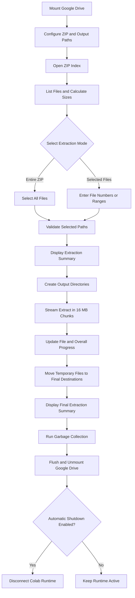

<div align="center">

# ⚡ ZipSieve

### Selective ZIP Extractor for Google Colab

Stop unpacking entire multi-GB archives just to grab one file. Peek inside a ZIP, pick exactly what you need, and stream it straight to Google Drive — with live progress bars, extraction statistics, and automatic resource cleanup.

[](https://www.python.org/)
[](https://colab.research.google.com/)
[](https://github.com/tqdm/tqdm)
[](LICENSE)
[](#)
[](#-contributing)

</div>

---

## ✨ Features

| Feature | Description |
|---|---|
| 📂 **Peek before you extract** | Lists every file inside the ZIP archive with individual sizes and cumulative uncompressed size before extraction. |
| 🎯 **Selective extraction** | Extract only the files you choose instead of unpacking the entire archive. |
| 🔢 **Flexible file selection** | Select individual files (`1,3,7`) or ranges (`1-5`, `1,3-5,8`). |
| 📊 **Dual progress bars** | Track both individual file extraction and overall extraction progress. |
| ⏱️ **ETA and live statistics** | View progress, transferred bytes, processing speed, and estimated remaining time through `tqdm`. |
| 🧩 **Chunked streaming reads** | Reads files in configurable 16 MB chunks, avoiding loading entire multi-GB files into RAM. |
| 📁 **Preserves folder structure** | Automatically recreates nested directories from the original ZIP archive. |
| ⚡ **Speed and timing statistics** | Displays extraction speed in MB/s and elapsed time for each file. |
| 📈 **Overall extraction summary** | Reports the number of extracted files, total data transferred, execution time, and output location. |
| 🛡️ **ZIP path validation** | Prevents unsafe archive paths from writing files outside the configured output directory. |
| 📝 **Temporary file handling** | Extracts into temporary `.part` files and moves them into their final destinations only after successful extraction. |
| 🔗 **Google Drive integration** | Reads ZIP archives from Google Drive and saves extracted files directly to the selected Drive folder. |
| 🧹 **Memory cleanup** | Runs Python garbage collection after processing to release unused Python objects. |
| 💾 **Drive flush and unmount** | Flushes pending Google Drive changes and optionally unmounts Drive after successful extraction. |
| 🔌 **Optional runtime shutdown** | Provides an option to disconnect and release the Google Colab runtime automatically after successful extraction. |
| 🪶 **Minimal dependencies** | Uses Python standard libraries and `tqdm`, which is preinstalled in Google Colab. |

---

## 🧠 How It Works



### Extraction Workflow

1. **Mount Google Drive** — Connect your Google Drive to the Colab runtime using `drive.mount("/content/drive")`.
2. **Configure the archive** — Specify the full path of your source ZIP file and the destination directory.
3. **Index the archive** — Python's `zipfile` module reads the ZIP archive's directory information without extracting its contents.
4. **Browse archive contents** — Every file is displayed with its index number, individual size, and cumulative uncompressed size.
5. **Select files** — Choose between extracting the entire archive or selecting specific files using numbers and ranges.
6. **Validate file paths** — Selected archive entries are checked to prevent unsafe paths from escaping the output directory.
7. **Confirm selection** — The script displays the selected files, their individual sizes, and the total amount of data to be extracted.
8. **Stream extraction** — Each file is read in configurable chunks (16 MB by default) and written directly to Google Drive. This avoids loading the entire file into memory.
9. **Track progress** — Two progress bars provide visibility into the extraction process: individual file progress and overall extraction progress across all selected files.
10. **Complete file extraction** — Each successfully extracted temporary file is renamed to its final filename.
11. **Display final statistics** — The script reports the number of extracted files, total data transferred, extraction speed, elapsed time, and destination folder.
12. **Clean up resources** — Python garbage collection is triggered, and Google Drive can be flushed and unmounted after successful extraction.
13. **Optional runtime shutdown** — When enabled, the script attempts to disconnect and release the Colab runtime automatically.

---

## 🚀 Quick Start

Run the following cells in order inside a Google Colab notebook.

### Step 1 — Mount Google Drive

```python
from google.colab import drive

drive.mount("/content/drive")
```

Authorize Google Drive access when prompted.

### Step 2 — Configure the extractor

Update the configuration section in the ZipSieve extraction cell.

```python
ZIP_FILE = "/content/drive/MyDrive/your_archive.zip"

OUTPUT_DIR = "/content/drive/MyDrive/extracted"

CHUNK_SIZE = 16 * 1024 * 1024  # 16 MB
```

### Step 3 — Configure resource cleanup

```python
UNMOUNT_DRIVE_AFTER_SUCCESS = True

SHUTDOWN_RUNTIME_AFTER_SUCCESS = False
```

The recommended settings flush and unmount Google Drive after a successful extraction while keeping the Colab runtime active.

### Step 4 — Run the extractor

Execute the complete extraction cell. You will be presented with the following options:

```text
================================================================================
                         🎯 EXTRACTION OPTIONS
================================================================================

1. 📦 Extract the entire ZIP file
2. 🎯 Extract selected files

Select extraction option (1 or 2):
```

### Step 5 — Choose files

For selective extraction, enter file numbers or ranges.

```text
Enter file numbers or ranges (Example: 1,3,7 or 1-5):
```

Examples:

| Input | Result |
|---|---|
| `1` | Extract file 1 |
| `1,3,7` | Extract files 1, 3, and 7 |
| `1-5` | Extract files 1 through 5 |
| `1,3-5,8` | Extract files 1, 3, 4, 5, and 8 |

Invalid inputs and out-of-range file numbers are ignored with warnings.

### Step 6 — Monitor extraction

ZipSieve displays live progress while extracting. You can monitor the current file, individual and overall progress, transferred data, extraction speed, and estimated remaining time.

After completion, the final summary displays the extraction statistics and output location.

---

## 📊 Progress Monitoring

ZipSieve uses `tqdm` to provide two levels of extraction progress.

### 1. Individual File Progress

Displays the extraction progress of the file currently being processed.

```text
⚡ Current file:  65%|██████▌   | 6.5G/10G
```

### 2. Overall Extraction Progress

Displays the combined progress of all selected files.

```text
📊 Overall progress: 65%|██████▌ | 13G/20G
```

Both progress bars provide byte counts, transfer speed, and estimated remaining time through `tqdm`.

---

## ⚙️ Configuration

Customize the following variables according to your requirements.

| Variable | Description | Default |
|---|---|---|
| `ZIP_FILE` | Full path to the source `.zip` file | Must be configured |
| `OUTPUT_DIR` | Destination directory for extracted files | `/content/drive/MyDrive/One Piece` |
| `CHUNK_SIZE` | Number of bytes read during each extraction operation | `16 * 1024 * 1024` (16 MB) |
| `UNMOUNT_DRIVE_AFTER_SUCCESS` | Flush and unmount Google Drive after successful extraction | `True` |
| `SHUTDOWN_RUNTIME_AFTER_SUCCESS` | Automatically disconnect and release the Colab runtime after successful extraction | `False` |

### Resource Cleanup Settings

**1. Python memory cleanup**

```python
gc.collect()
```

Requests garbage collection to release unused Python objects.

**2. Google Drive cleanup**

```python
from google.colab import drive

drive.flush_and_unmount()
```

Flushes pending Drive changes and unmounts Google Drive from the runtime.

**3. Optional Colab runtime shutdown**

```python
from google.colab import runtime

runtime.unassign()
```

Attempts to disconnect and release the Colab runtime.

To enable automatic shutdown, change:

```python
SHUTDOWN_RUNTIME_AFTER_SUCCESS = True
```

> ⚠️ **Important:** Runtime shutdown is optional. Once disconnected, you cannot continue using the current runtime without reconnecting. Make sure extraction has completed and Drive changes have been flushed before enabling it.

---

## 🛡️ Safety and File Handling

ZipSieve includes additional safeguards for handling ZIP archives.

| Protection | Behaviour |
|---|---|
| Path traversal prevention | Rejects archive entries attempting to write outside the configured output directory. |
| Absolute path prevention | Rejects absolute Unix and Windows paths. |
| Temporary extraction | Writes incomplete files using the `.part` extension. |
| Successful file completion | Renames temporary files to their final names only after extraction completes. |
| Error handling | Removes incomplete temporary files when an individual extraction fails. |
| Duplicate selection handling | Removes duplicate file numbers while preserving selection order. |
| Invalid selection handling | Skips invalid inputs and displays warnings. |

> **Note:** Existing destination files with matching names can be replaced when a new extraction completes. The source ZIP archive is never deleted by ZipSieve.

---

## 💡 Why Chunked Extraction?

Extracting a large file by reading its entire contents into memory can consume a substantial amount of RAM.

ZipSieve instead reads and writes the archive contents incrementally.

For example, a 10 GB file is processed in 16 MB chunks rather than loading the entire 10 GB file into memory. This helps maintain more predictable memory usage, which is particularly useful when working with Google Colab's free-tier runtime.

The chunk size can be adjusted through `CHUNK_SIZE`.

---

## 📋 Requirements

- Google Colab or a compatible Jupyter environment.
- Python 3.8+.
- Google Drive access.
- `tqdm` for progress monitoring.

Most dependencies are part of the Python standard library.

For environments where `tqdm` is not installed:

```bash
pip install tqdm
```

---

## 📁 Suggested Repository Structure

```text
zipsieve/
│
├── zipsieve.ipynb        # Main Google Colab notebook
│                         # Drive mount and extraction code
│
├── README.md             # Project documentation
│
└── LICENSE               # MIT License
```

---

## ⚠️ Important Notes

- `ZIP_FILE` must point directly to a ZIP file, not a directory.
- Ensure sufficient free storage is available in Google Drive before extraction.
- ZIP archive indexing reads the archive's directory metadata; very large archives with many entries may take longer to open.
- Extraction speed depends on archive compression, the selected files, runtime resources, and Google Drive performance.
- Chunked extraction reduces the need to hold large file contents in RAM, but does not eliminate all memory or storage requirements.
- Drive unmounting happens only after successful extraction when the setting is enabled.
- When extraction fails or is interrupted, the runtime is not automatically shut down.
- The original ZIP archive and successfully extracted files are retained.

---

## 🤝 Contributing

Contributions, issues, and feature suggestions are welcome!

Potential future improvements include:

- Non-interactive / CLI extraction mode.
- Wildcard and regular-expression file selection.
- Checksum verification after extraction.
- Pause and resume extraction.
- Extraction history and logging.
- Graphical file-selection interface.
- Support for additional archive formats such as `.7z` and `.rar`.

Feel free to open an issue or submit a pull request.

---

## 📄 License

Released under the [MIT License](LICENSE).

---

<div align="center">

**⚡ ZipSieve — Extract Only What You Need.**

Made with Python and Google Colab.

</div>
